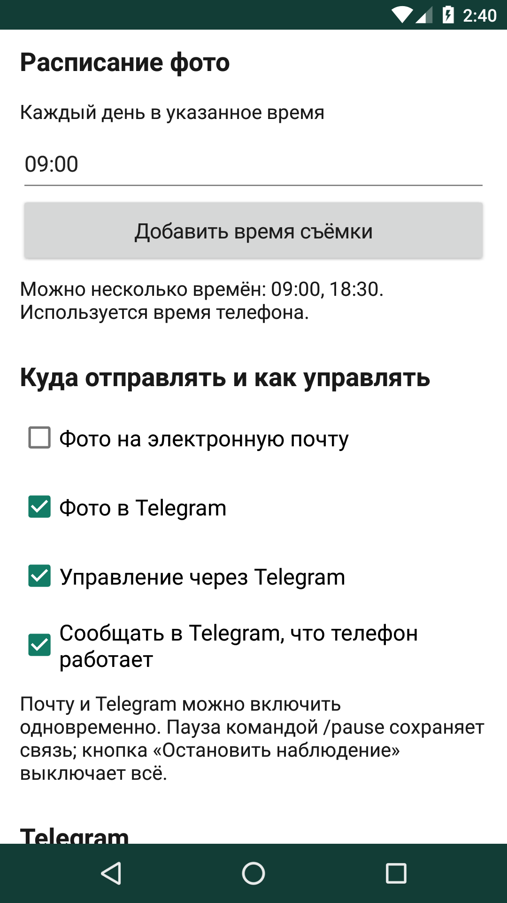
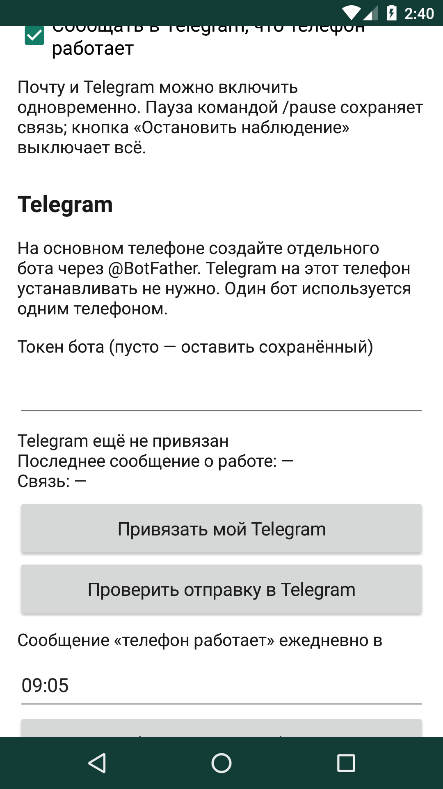

# Boiler Watch · Котёл под присмотром

[](https://github.com/dench1ka/boiler-watch/actions/workflows/android.yml)

Android-приложение для ежедневных фотографий показаний котла. Старый телефон остаётся рядом с котлом, снимает его в заданное время и отправляет фото **в Telegram, на почту или одновременно в оба канала**.

Расписание, камера и способы отправки настраиваются на телефоне. Через Telegram можно запросить фото, посмотреть состояние, изменить расписание и приостановить съёмку. Платный хостинг и отдельный сервер не требуются.

**Версия:** 0.2.0 · **Минимум:** Android 6.0 / API 23 · **Целевая версия:** Android 15 / API 35.

Первоначальное целевое устройство — Redmi 4A с Android 7.1.2 и MIUI 10.2.3. Автотесты выполнены на эмуляторах Android 7.1.1 и Android 15. Проверка на физическом Redmi ещё предстоит.

## Возможности

- Одно или несколько ежедневных времён, например `09:00, 18:30`, по часовому поясу телефона.
- Независимые галочки для почты, Telegram, удалённых команд и ежедневного сообщения «телефон работает».
- Telegram-only режим: без SMTP и без установленного Telegram на телефоне у котла.
- SMTP с TLS или обязательным STARTTLS и проверкой сертификатов.
- Локальная очередь снимков и повторные попытки доставки после восстановления связи.
- Отдельные подтверждения каждого канала: сбой почты не требует повторно отправлять уже доставленное фото в Telegram, и наоборот.
- Выбор камеры, вспышки и поворота. Пробный снимок без отправки.
- Автоматическое восстановление после перезагрузки на Android 6–8.1, если наблюдение было включено.
- Крупные подписи и кнопки, скрытие неиспользуемых настроек, без сложных анимаций.
- Токен бота и SMTP-пароль шифруются через Android Keystore; резервное копирование данных отключено.

## Как выглядит

<p>
  
  
  
</p>

## Быстрый запуск

1. **Получите APK.** Соберите проект по инструкции ниже либо откройте успешный запуск [GitHub Actions](https://github.com/dench1ka/boiler-watch/actions/workflows/android.yml), скачайте артефакт `Android-build-and-reports` и найдите в нём `app/build/outputs/apk/debug/app-debug.apk`.
2. Установите APK на телефон у котла, откройте приложение и разрешите камеру. На Android 13+ разрешите уведомления.
3. Нажмите **«Пробный снимок без отправки»**. Закрепите телефон и убедитесь, что показания читаются. При необходимости измените камеру, поворот и вспышку.
4. Укажите ежедневное время или нажмите **«Добавить время съёмки»**. Для нескольких снимков задайте, например, `09:00, 18:30`.
5. Выберите нужные способы отправки и настройте их по разделам ниже.
6. Нажмите **«Сохранить настройки»**, затем **«Снять и отправить сейчас»**. Проверьте фактическое получение фотографии.
7. Нажмите **«Включить наблюдение»**, заблокируйте экран и проверьте ближайшее автоматическое срабатывание.

Для работы нужны интернет и питание. Настройки меняются при остановленном наблюдении; после изменений включите его снова. На Android 12+ отдельно разрешите точные таймеры кнопкой **«Доступ к точному времени съёмки»**.

Debug APK предназначен для испытаний. Для постоянного распространения следует собрать release APK и подписать его собственным постоянным ключом. Обычная release-сборка этого проекта создаёт **неподписанный** APK.

## Отправка и управление через Telegram

Telegram на телефоне у котла **не нужен**: приложение само выполняет HTTPS-запросы к Bot API. Telegram-аккаунт нужен только на основном телефоне владельца.

1. На основном телефоне создайте отдельного бота через **@BotFather** → `/newbot`.
2. В приложении включите нужные галочки Telegram. Если почта не нужна, снимите галочку **«Фото на электронную почту»**.
3. Вставьте токен бота и нажмите **«Привязать мой Telegram»**.
4. Приложение покажет одноразовый код. В личном чате со своим ботом отправьте `/pair 12345678`, подставив этот код. Он действует 10 минут.
5. Дождитесь подтверждения привязки, сохраните настройки и нажмите **«Проверить отправку в Telegram»**.
6. Включите наблюдение.

У бота есть кнопки **«Статус»**, **«Фото сейчас»**, **«Пауза»**, **«Продолжить»**, **«Расписание»**, **«Помощь»**. Команды принимаются только от привязанного пользователя в личном чате.

| Команда | Действие |
| --- | --- |
| `/status` | Состояние, расписание, последняя доставка и очередь |
| `/photo` | Новый снимок с отправкой выбранными в приложении каналами |
| `/times 09:00, 18:30` | Новое ежедневное расписание |
| `/pause` / `/resume` | Пауза и возобновление автоматической съёмки |
| `/recipient name@example.org` | Получатель будущих писем |
| `/alive on` / `/alive off` | Ежедневные сообщения о работе |
| `/alive_time 09:05` | Время сообщения о работе |
| `/help` | Все команды, включая камеру, вспышку и поворот |

**«Пауза» сохраняет удалённую связь. «Остановить наблюдение» в приложении выключает всё, включая команды Telegram.** После полной остановки нужно вручную включить наблюдение на телефоне.

Используйте одного отдельного бота для одного телефона. Другие программы или настроенный webhook этого бота могут помешать получению команд. Токен вводится непосредственно в приложение; публиковать его в Issues и исходниках не нужно.

Подробная инструкция, защита команд, поведение очереди и перепривязка — в [TELEGRAM.md](TELEGRAM.md).

## Отправка на почту

Включите **«Фото на электронную почту»** и укажите:

- SMTP-сервер и порт;
- TLS сразу при подключении (обычно `465`) либо обязательный STARTTLS (обычно `587`);
- логин и пароль приложения;
- адрес отправителя и один адрес получателя.

Точные параметры зависят от почтового провайдера. OAuth пока не реализован: нужен SMTP с логином и паролем/паролем приложения. Пустое поле пароля оставляет сохранённый пароль; при смене сервера или логина пароль нужно ввести заново.

Проверьте вложение и папку «Спам». Статус отправки означает принятие SMTP-сервером, а не гарантированное появление во «Входящих».

## Автозапуск и настройка Xiaomi

На Android 6–8.1 приложение обрабатывает `BOOT_COMPLETED`: восстанавливает таймеры и запускает фоновую работу, если наблюдение было включено. Выключенное наблюдение после перезагрузки остаётся выключенным.

На Xiaomi / MIUI перед установкой на даче:

1. Разрешите приложению **автозапуск**.
2. Выберите работу **без ограничений батареи**, проверьте разрешение камеры. При необходимости закрепите приложение в недавних.
3. Включите автоматическую дату и время.
4. Перезагрузите телефон и проверьте автоматический снимок, не открывая приложение. При защите запуска PIN/паролем может потребоваться первое разблокирование.

Названия пунктов зависят от MIUI. Принудительная остановка приложения в системных настройках блокирует его автоматическую работу до следующего ручного открытия.

| Android | Поведение этой версии приложения |
| --- | --- |
| 6–8.1 | Автовосстановление расписания и запуск после загрузки; требуется настройка ограничений производителя |
| 9–11 | Консервативный режим: camera-сервис запускается из открытого приложения; после остановки сервиса или перезагрузки нужно ручное возобновление |
| 12–15 | Дополнительно проверяются доступ к точным таймерам, уведомления и ограничения foreground camera-сервиса |
| 16+ | Не проверялся |

Автозапуск, таймер и реальная съёмка после перезагрузки проверены на стандартном Android 7.1.1 / API 25. Эмулятор не воспроизводит особенности MIUI.

## Очередь, повторы и ограничения

- Снимок сначала сохраняется во внутреннее хранилище, затем отправляется. В отчёте указаны фактическое время съёмки и ID.
- Выбранные каналы и получатели фиксируются при съёмке. Изменение настроек не переназначает уже сохранённые отчёты.
- При сбоях доставки повтор выполняется через 5, 10, 20, 40, затем 60 минут, пока наблюдение включено. Android может задерживать фоновую работу и сеть.
- У каждого канала своя запись подтверждения. Разрыв связи после принятия сообщения сервером, но до локального подтверждения, всё ещё может вызвать дубль.
- Отправленные снимки хранятся 7 дней. Неотправленные автоматически не удаляются. Предел архива — 100 МБ; при остатке места меньше 20 МБ новая съёмка приостанавливается, доставка старых фото продолжается. Проверка происходит перед снимком, поэтому порог может быть превышен на размер одного кадра.
- После длительного простоя снимается актуальное фото; отсутствующие исторические снимки восстановить нельзя.
- Из интерфейса пока нельзя удалить или переназначить отдельные задания очереди.
- Если телефон выключен или полностью потерял связь, самостоятельно предупредить об этом он не сможет. Внешнего контроля пропущенных отчётов в проекте нет.
- Автоматического распознавания показаний и аварий котла нет: приложение передаёт фотографии для визуальной проверки.

## Сборка из исходников

### Требования

- JDK 17;
- Android SDK Platform 35, Build Tools 35.0.0 и Platform Tools для ADB;
- Python 3.10+ для скриптов проверки;
- интернет для первой загрузки Gradle и зависимостей.

Используются Kotlin 2.1.20, Android Gradle Plugin 8.9.2 и Gradle 8.11.1. В проект включён стандартный Gradle Wrapper.

### Android Studio

Откройте корень проекта, выберите JDK 17, установите SDK 35 и дождитесь Gradle Sync. Затем соберите APK через меню сборки IDE.

### Командная строка — macOS / Linux

Укажите `JAVA_HOME` и `ANDROID_HOME` либо задайте `sdk.dir` в локальном `local.properties`:

```sh
git clone https://github.com/dench1ka/boiler-watch.git
cd boiler-watch

# При наличии sdkmanager в PATH:
sdkmanager 'platforms;android-35' 'build-tools;35.0.0' 'platform-tools'

# Проверка окружения, unit-тесты, Lint и сборки APK:
./scripts/build.sh
```

Скрипт использует установленный Gradle либо загружает 8.11.1 в `.tools`, проверяя контрольную сумму. Отдельная сборка через стандартный Wrapper:

```sh
./gradlew check lintRelease assembleDebug assembleRelease assembleDebugAndroidTest
```

| Файл | Назначение |
| --- | --- |
| `app/build/outputs/apk/debug/app-debug.apk` | Тестовая установка |
| `app/build/outputs/apk/release/app-release-unsigned.apk` | Release APK, требует подписи |
| `app/build/outputs/apk/androidTest/debug/app-debug-androidTest.apk` | Инструментальные тесты |

Ключи подписи, пароли и локальные настройки не должны попадать в Git. Для обновления установленного приложения с сохранением данных используйте тот же ключ подписи.

## Тестирование и CI

Последний локальный прогон: **334 выполнения тестов без падений и пропусков**, Lint без ошибок. Дополнительно прошли три проверки с двумя настоящими перезагрузками эмулятора. Оставшиеся предупреждения и границы проверки описаны в [TESTING.md](TESTING.md); сводка сохранена в [docs/testing/local-verification.json](docs/testing/local-verification.json).

```sh
# Без JDK и Android SDK: проверки скриптов и манифеста
python3 -m unittest discover -s tests -v

# Полный цикл с подключёнными устройствами/эмуляторами
python3 scripts/verify.py --device
```

Для камерных тестов нужен эмулятор с синтетической камерой:

```sh
emulator -avd YOUR_AVD -no-window -no-audio -no-snapshot \
  -gpu swiftshader -camera-back emulated -camera-front none
```

Проверка настоящей перезагрузки выполняется отдельно и **очищает данные приложения только на тестовом эмуляторе Android 6–8.1**. Реальные телефоны скриптом запрещены:

```sh
python3 scripts/test-reboot.py --serial emulator-5554
```

[GitHub Actions](.github/workflows/android.yml) собирает APK, запускает unit-тесты и Lint, затем инструментальные тесты на API 25 и 35 и перезагрузки на API 25. Отчёты и APK доступны в артефактах соответствующего запуска. Первую загрузку зависимостей CI выполняет самостоятельно; токены бота и SMTP-пароли для тестов не нужны.

`verify.py` сохраняет журналы в локальную папку `artifacts/verification`. Код `0` означает успех всех запрошенных проверок, `1` — падение, `2` — отсутствующее окружение или незапущенный этап. Без `--device` инструментальные тесты помечаются `not_run`, а не успешными.

## Перед установкой на даче

Проведите испытание на самом Redmi не менее 48–72 часов: читаемость показаний днём и ночью, заблокированный экран, отключение/возврат интернета, перезагрузка, настоящие почта и Telegram. Автотесты с фикстурами и эмуляторами не подтверждают работу конкретной прошивки и почтового аккаунта.

## Структура проекта

- `app/src/main` — интерфейс, камера, расписание, очередь, SMTP и Telegram.
- `app/src/test` — JUnit и Robolectric.
- `app/src/androidTest` — проверки на Android-устройстве/эмуляторе.
- `scripts` — сборка, проверка окружения, общий прогон и проверка перезагрузок.
- `docs` — скриншоты и обезличенная сводка локального прогона.
- [TELEGRAM.md](TELEGRAM.md) — полная настройка и команды Telegram.
- [TESTING.md](TESTING.md) — результаты и воспроизводимость проверок.
- [SECURITY.md](SECURITY.md) — хранение секретов и публикация данных.
