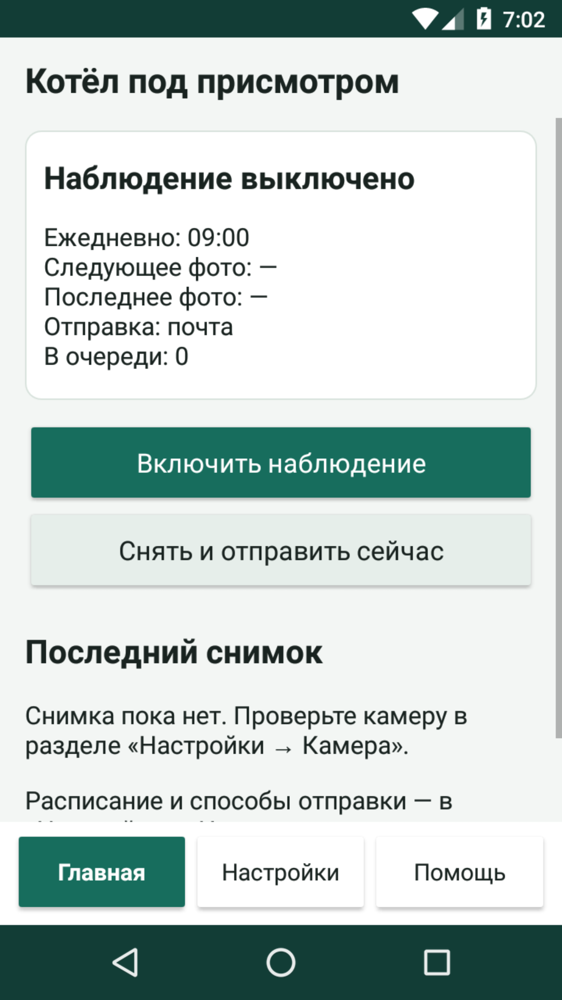
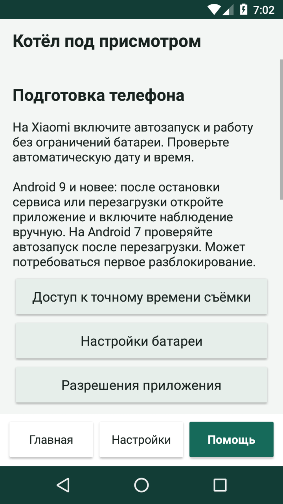

# Boiler Watch · Котёл под присмотром

[](https://github.com/dench1ka/boiler-watch/actions/workflows/android.yml)

Android-приложение для фотографий показаний котла по расписанию. Телефон остаётся рядом с котлом, снимает его в заданное время и отправляет исходный JPEG на электронную почту через SMTP.

**Версия 0.3.0 · Android 6.0+ / API 23 · target API 35.**

В этой версии оставлены расписание, камера, SMTP и очередь доставки. Удалены Telegram, удалённые команды, привязка аккаунта и таймеры проверки связи. Сервер приложения, бот и отдельное приложение почты на телефоне не нужны.

[Скачать APK 0.3.0](https://github.com/dench1ka/boiler-watch/releases/download/v0.3.0/BoilerWatch-0.3.0.apk) · [Релиз и контрольная сумма](https://github.com/dench1ka/boiler-watch/releases/tag/v0.3.0).

## Возможности

- Одно или несколько ежедневных времён, например `09:00, 18:30`, по часовому поясу телефона.
- Максимальное разрешение, сообщаемое выбранной камерой через Android Camera API, и качество JPEG 100. Приложение не обрезает и не пересжимает снимок после съёмки.
- Выбор передней/задней камеры, вспышки и поворота; пробный снимок без отправки.
- Отправка через SMTP с TLS либо обязательным STARTTLS и проверкой сертификата и имени сервера.
- Локальная очередь и повторные попытки доставки. Сначала отправляется новый снимок, затем архив.
- Восстановление работы после перезагрузки на Android 6–8.1, если наблюдение было включено.
- Три раздела: «Главная», «Настройки», «Помощь». В настройках только «Расписание», «Электронная почта» и «Камера».
- SMTP-пароль шифруется через Android Keystore. Фото и настройки исключены из резервного копирования.

## Как выглядит

<p>
  
  
  
</p>

[Настройки SMTP](docs/images/email.png). Скриншоты версии 0.3.0 на эмуляторе Android 15, ширина интерфейса 360 dp.

## Быстрый запуск

1. Установите APK на телефон у котла. Для обновления поверх предыдущей версии требуется тот же ключ подписи.
2. Откройте приложение и разрешите камеру. На Android 13+ разрешите уведомления.
3. В «Настройки → Камера» сделайте «Пробный снимок без отправки» и проверьте читаемость показаний.
4. В «Настройки → Расписание» задайте время съёмки. Можно добавить несколько времён.
5. В «Настройки → Электронная почта» заполните SMTP-сервер, порт, логин, пароль приложения и адрес получателя. Пустой адрес отправителя берётся из логина.
6. Нажмите «Сохранить настройки», затем «Снять и отправить сейчас» и проверьте получение фотографии.
7. Нажмите «Включить наблюдение», заблокируйте экран и проверьте ближайшее автоматическое срабатывание.

Для изменения настроек нажмите «Остановить и настроить». После сохранения включите наблюдение снова. Телефону нужны интернет, питание и корректные дата/время.

## Почта Gmail

В Google-аккаунте включите двухэтапную аутентификацию и создайте [пароль приложения](https://myaccount.google.com/apppasswords). Подробности и ограничения аккаунтов — в [справке Google](https://support.google.com/accounts/answer/185833?hl=ru).

| Поле | Значение |
| --- | --- |
| SMTP-сервер | `smtp.gmail.com` |
| Порт | `465` |
| TLS сразу при подключении | Включено |
| Логин SMTP | Полный адрес Gmail |
| Пароль приложения | Созданный пароль из 16 символов без пробелов |
| Отправитель | Тот же адрес Gmail |
| Получатель | Нужный адрес, можно тот же Gmail |

Для других провайдеров используйте их SMTP-параметры: обычно порт 465 с TLS сразу или 587 с обязательным STARTTLS. OAuth в приложении не реализован.

Пустое поле пароля сохраняет прежний пароль; при смене сервера или логина пароль нужно ввести заново. После сохранения поле очищается. Ошибка «Проверьте логин и пароль приложения» означает отказ SMTP при входе. Проверьте также папку «Спам»: принятие письма сервером не гарантирует появление во «Входящих».

## Подготовка телефона и фоновая работа

На Xiaomi/MIUI разрешите автозапуск, выберите работу без ограничений батареи, проверьте разрешение камеры. При необходимости закрепите приложение в недавних. Включите автоматические дату и время.

На Android 12+ отдельно разрешите точные таймеры: «Помощь → Доступ к точному времени съёмки».

| Android | Поведение |
| --- | --- |
| 6–8.1 | Восстановление расписания и запуск после загрузки; ограничения производителя нужно настроить |
| 9–11 | После остановки camera-сервиса или перезагрузки нужно открыть приложение и вручную возобновить наблюдение |
| 12–15 | Дополнительно нужны доступ к точным таймерам и учёт ограничений foreground camera-сервиса |
| 16+ | Не проверялся |

При включённом наблюдении остаётся сервис с уведомлением, системными таймерами и обработчиком восстановления сети. Постоянного опроса сервера и удалённых команд нет. Камера открывается на время съёмки. Экран можно выключить.

Принудительная остановка в системных настройках блокирует автоматическую работу до ручного открытия. После перезагрузки может потребоваться первое разблокирование телефона. Физический Redmi 4A с MIUI необходимо проверить отдельно: эмулятор не воспроизводит ограничения его прошивки.

## Фотографии и очередь

Фото сначала сохраняется во внутреннем хранилище приложения, затем исходный файл прикладывается к письму без уменьшения. Уменьшенное превью на главной не меняет вложение. В галерею фото автоматически не добавляются.

- Отправленные фото хранятся 7 дней после перемещения в архив; очистка выполняется при обработке архива. Неотправленные автоматически не удаляются.
- Пробный снимок хранится отдельно и заменяется следующим пробным снимком; в почтовую очередь он не попадает.
- Предел архива — 100 МБ. При заполнении архива или остатке свободного места меньше 20 МБ новая съёмка приостанавливается, доставка накопленного продолжается. Проверка выполняется перед снимком, поэтому предел может быть превышен на размер одного фото.
- Максимальное разрешение и JPEG 100 увеличивают размер файлов; число помещающихся в архив снимков зависит от камеры и сцены.
- Адрес получателя фиксируется при съёмке. Изменение адреса не переназначает старые письма.
- Текущее фото отправляется перед старыми. При восстановлении связи первым отправляется самый свежий сохранённый снимок, затем остальные.
- Старые фото помечаются «Из очереди», с фактическим временем съёмки и плановым временем.
- При сбоях повторы через 5, 10, 20, 40, затем 60 минут. Восстановление сети также запускает обработку очереди. Android может задерживать фоновую работу.
- Подтверждение отправки хранится на диске. Разрыв связи после принятия письма сервером, но до локального подтверждения, всё ещё может привести к дублю.
- Перед ближайшим временем съёмки архив уступает ей место. Уже начатый сетевой запрос завершается перед следующей операцией.
- Удаление приложения или очистка его данных удаляет локальные снимки и настройки. Полученные письма остаются в почтовом ящике.

Распознавания показаний и аварий нет: приложение передаёт фотографии для визуальной проверки. Выключенный телефон не сможет самостоятельно предупредить о потере связи.

## Обновление с 0.2.x

Настройки SMTP, зашифрованный пароль, расписание и снимки сохраняются при установке поверх приложения с той же подписью. Старые секреты удалённого управления и его таймеры удаляются однократно. Если раньше почта была выключена либо съёмка была на паузе, наблюдение остаётся выключенным до ручной настройки и включения.

Старые письма продолжают отправляться исходным получателям. Уже подтверждённые письма не отправляются заново. Старые снимки, для которых отправка на почту не выбиралась, перемещаются в локальный архив без перенаправления новому получателю и далее подчиняются сроку хранения архива.

## Сборка и проверки

Нужны JDK 17, Android SDK Platform 35, Build Tools 35.0.0, Platform Tools и Python 3.10+. Проект использует Kotlin 2.1.20, Android Gradle Plugin 8.9.2 и Gradle 8.11.1.

```sh
# Укажите JAVA_HOME и ANDROID_HOME или sdk.dir в local.properties.
./scripts/build.sh
# Либо через Wrapper:
./gradlew check lintRelease assembleDebug assembleRelease assembleDebugAndroidTest
# Проверки без Android SDK:
python3 -m unittest discover -s tests -v
# Полный прогон с подключённым тестовым эмулятором:
python3 scripts/verify.py --device
```

| Файл | Назначение |
| --- | --- |
| `app/build/outputs/apk/debug/app-debug.apk` | Тестовая установка |
| `app/build/outputs/apk/release/app-release-unsigned.apk` | Release APK, требует подписи |
| `app/build/outputs/apk/androidTest/debug/app-debug-androidTest.apk` | Инструментальные тесты |

Скрипт сборки использует установленный Gradle либо загружает проверенный дистрибутив в `.tools`. Для эмулятора нужна синтетическая камера (`-camera-back emulated`). Проверка настоящих перезагрузок `python3 scripts/test-reboot.py --serial emulator-5554` очищает данные только тестового эмулятора Android 6–8.1; реальные телефоны скриптом запрещены.

[GitHub Actions](.github/workflows/android.yml) выполняет сборку, unit-тесты, Lint, инструментальные проверки API25/API35 и перезагрузки API25. Тесты используют локальные фикстуры и не отправляют письма в настоящие аккаунты.

Локально прошли 286 выполнений тестов без падений и пропусков, Lint — без ошибок. [GitHub Actions для 0.3.0](https://github.com/dench1ka/boiler-watch/actions/runs/43741881858) также завершился успешно: сборка, API25/API35 и перезагрузки API25.

[Результаты проверок](TESTING.md) · [Хранение секретов](SECURITY.md).
